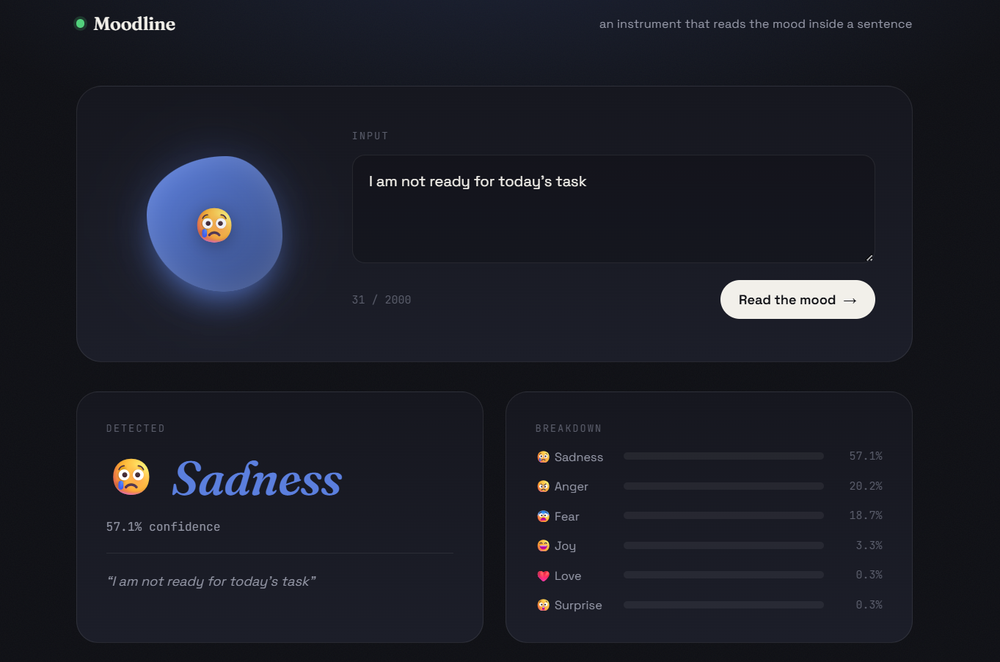

# Moodline — Text-Based Emotion Prediction

Moodline is a text emotion-classification web application that analyzes a sentence and predicts the emotion expressed in it. It displays the most likely emotion along with its confidence score and a probability breakdown across six emotion categories.

## Screenshot



## Features

- **Text-based emotion detection:** Enter a sentence of up to 2,000 characters for analysis.
- **Six emotion categories:** Sadness, Joy, Love, Anger, Fear, and Surprise.
- **Confidence score:** View the confidence associated with the predicted emotion.
- **Probability breakdown:** Compare the model's scores across all six categories.
- **Web interface:** Use the application through a browser.
- **REST API:** Submit text for prediction through a FastAPI endpoint.
- **Health check:** Check whether the API is running and the model has loaded.

## How It Works

The application uses a trained Bidirectional GRU (BiGRU) model and a saved tokenizer to classify text.

1. The user enters a sentence in the web interface.
2. The FastAPI backend receives and validates the text.
3. Text preprocessing converts the input to lowercase, removes apostrophes and special characters, and normalizes whitespace.
4. The tokenizer converts the cleaned text into a sequence of integers.
5. The sequence is padded or truncated to a fixed length of 50 tokens.
6. The BiGRU model generates scores for the six emotion classes.
7. The API returns the predicted emotion, its confidence, and the probability scores for all classes.

The trained model and tokenizer are loaded when the FastAPI application starts.

## Tech Stack

- **Language:** Python
- **Deep Learning:** TensorFlow / Keras
- **Model:** Bidirectional GRU (BiGRU)
- **Backend:** FastAPI, Uvicorn, Pydantic
- **Numerical processing:** NumPy
- **Frontend:** HTML, CSS, JavaScript
- **Model artifacts:** Keras model (`.keras`) and serialized tokenizer (`.pkl`)

## Project Structure

```text
Emotion-Prediction/
├── Artifacts/
│   ├── BiGRU_Model.keras
│   └── tokenizer.pkl
├── static/
│   └── Frontend assets (HTML, CSS, JavaScript)
├── screenshots/
│   └── moodline-demo.png
├── final_clean.ipynb
├── main.py
├── requirements.txt
└── runtime.txt
```

## Getting Started

### Prerequisites

- Python 3.11 or a compatible version supported by the pinned dependencies
- Git
- pip

### 1. Clone the repository

```bash
git clone https://github.com/<your-github-username>/Emotion-Prediction.git
cd Emotion-Prediction
```

Replace `<your-github-username>` with the GitHub account that hosts your copy of the project.

### 2. Create and activate a virtual environment

**Windows PowerShell:**

```powershell
python -m venv venv
venv\Scripts\Activate.ps1
```

**Windows Command Prompt:**

```bat
python -m venv venv
venv\Scripts\activate
```

**macOS / Linux:**

```bash
python3 -m venv venv
source venv/bin/activate
```

### 3. Install dependencies

```bash
python -m pip install --upgrade pip
pip install -r requirements.txt
```

### 4. Start the application

Run this command from the project root (the folder containing `main.py`):

```bash
uvicorn main:app --reload
```

Open the application in your browser:

```text
http://127.0.0.1:8000
```

## API Reference

The backend exposes the following endpoints:

| Method | Endpoint | Description |
|---|---|---|
| `GET` | `/` | Serves the web application |
| `GET` | `/health` | Returns server status and whether the model is loaded |
| `POST` | `/predict` | Predicts the emotion expressed in the submitted text |
| `GET` | `/docs` | Opens the interactive Swagger API documentation |

### Predict Emotion

**Request**

```http
POST /predict
Content-Type: application/json
```

```json
{
  "text": "I am extremely happy because I got my dream job!"
}
```

**Response shape**

```json
{
  "text": "I am extremely happy because I got my dream job!",
  "predicted_emotion": "joy",
  "confidence": 0.95,
  "all_probabilites": {
    "sadness": 0.01,
    "joy": 0.95,
    "love": 0.01,
    "anger": 0.01,
    "fear": 0.01,
    "surprise": 0.01
  }
}
```

The values above illustrate the response format only; actual predictions and scores depend on the input.

### Health Check

Open:

```text
http://127.0.0.1:8000/health
```

The response includes the server status and a `model_loaded` boolean.

## Model Notes

- **Architecture:** Bidirectional GRU (BiGRU)
- **Input:** Preprocessed text converted into token sequences
- **Sequence length:** 50 tokens
- **Output classes:** Sadness, Joy, Love, Anger, Fear, and Surprise
- **Inference artifacts:** `Artifacts/BiGRU_Model.keras` and `Artifacts/tokenizer.pkl`

## Important Note

Moodline is an educational text-classification project. Its output is a model prediction based on learned patterns in text; it should not be treated as a clinical assessment, a mental-health diagnosis, or a definitive statement about a person's emotional state.